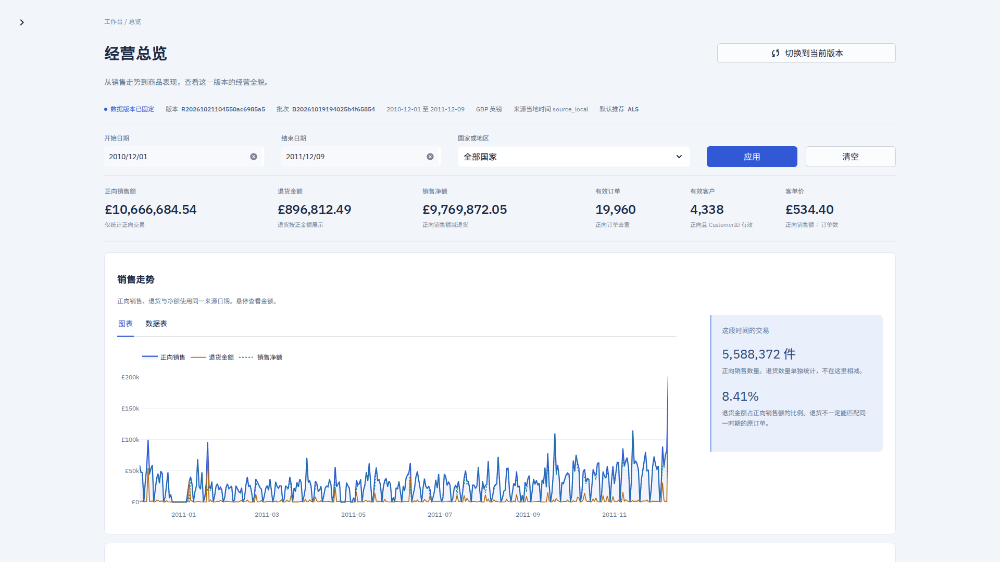

# 零售观察 · Hadoop 电商分析与推荐系统

基于真实零售交易数据的分析与推荐项目，覆盖数据导入、Hadoop 清洗聚合、四种推荐算法训练、版本发布和可视化查询。通过七页中文工作台，查看销售表现、客户分层、商品关联与推荐结果，并追踪数据质量和模型实验。



## 主要功能

- **销售与客户分析**：销售趋势、国家与商品排行、退货统计、RFM 客户分层和商品共购关系。
- **四种推荐算法**：POP、ItemCF、ALS、NCF（NeuMF），支持过滤已购商品和未知客户热门兜底。
- **模型实验对比**：按时间划分训练与评价数据，展示排名指标、训练曲线及真实 CPU/CUDA 性能对照。
- **流程与版本管理**：数据质量检查、任务追踪、原子版本发布、只读 API、隔离恢复演练和报告导出。

## 技术与数据

```text
交易 Excel → HDFS → Java MapReduce / YARN → 分析结果与模型训练
                                              ↓
                                  MariaDB → FastAPI → Streamlit
```

推荐模型使用 Spark 隐式 ALS 和 PyTorch NCF，其余算法由 Python 实现；页面使用 Streamlit 与 Plotly。运行环境为 WSL2 / Ubuntu、Python 3.12，Python 依赖由 uv 和 `uv.lock` 管理。

数据来自 [UCI Online Retail](https://archive.ics.uci.edu/dataset/352/online+retail)，包含 541,909 行原始交易记录，按 CC BY 4.0 使用，金额单位为英镑（GBP）。

## 本机运行

先按 [运行与演示手册](docs/delivery.md) 准备环境、数据库和已发布数据，再在仓库根目录分别启动两个终端。

API：

```bash
source scripts/dev-env.sh
uv run --locked python -m service --config config/development.toml \
  --db-defaults-file var/secrets/reader.cnf
```

页面：

```bash
source scripts/dev-env.sh
uv run --locked python -m app --config config/development.toml
```

访问 **<http://127.0.0.1:8501>**，接口文档位于 <http://127.0.0.1:8000/docs>。

页面通过 API 查询已发布的数据快照，筛选时重新查询；新数据经离线 CLI 处理、训练并发布后，可在页面切换到新版本。

## 文档导航

| 内容 | 入口 |
|---|---|
| 环境与初始化 | [配置和依赖](config/README.md) · [数据库迁移与角色](migrations/README.md) |
| 运行与演示 | [启动、更新数据与五分钟演示](docs/delivery.md) |
| 数据与模型 | [数据导入](etl/README.md) · [MapReduce 作业](mapreduce/README.md) · [推荐模型](ml/README.md) |
| 服务与发布 | [只读 API](service/README.md) · [前端页面](app/README.md) · [发布与恢复](orchestration/README.md) |
| 设计与交付 | [冻结设计基线](docs/README.md) · [交付复查记录](docs/execution/2026-10-25-handoff.md) · [实施历史汇总](docs/execution/2026-10-25-project-history.md) |
| 后续实验 | [GPU 优化实验方案](docs/gpu-optimization-plan.md)，优化实验尚未执行 |
