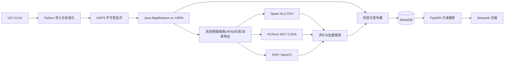

# 03 系统架构

版本 HL-DOC-1.0.0，FROZEN。

## 1. 组件和部署边界

所有组件运行在同一个 WSL2 发行版、hadoop 用户下。Windows 只运行编辑器和浏览器、提供 NVIDIA 驱动。HDFS/YARN 为单机伪分布式；Spark ALS local[2]；NCF单GPU。网络默认localhost，禁止将“多个进程”描述为“多个物理节点”。

| 组件 | 输入 | 输出 | 责任边界 |
|---|---|---|---|
| 导入器 | 指定本地XLSX与来源元信息 | HDFS原始文件、规范化TSV、batch记录 | 格式转换和可追溯，不做最终业务过滤 |
| 作业编排器 | batch、配置、任务名 | run记录、YARN应用、产物manifest | 检查依赖、串行重计算、失败和重试 |
| MapReduce | HDFS标准化/clean记录 | clean、聚合、RFM、共现、训练输入 | 大规模业务计算必须真实经YARN |
| 训练与评价 | 冻结特征、split、模型配置 | 模型、指标、训练历史、硬件记录 | 不读服务库反向修改训练数据 |
| 发布器 | 成功batch、四算法全量模型和结果 | READY release与current指针 | 唯一可写当前版本的组件 |
| API | release与筛选参数 | 固定版本JSON | 仅查询结果库；不启动Spark/PyTorch/SSH |
| UI | 用户筛选、API结果 | 图表/表格 | 不直连数据库，不读HDFS，不持有写入凭据 |

## 2. 批次、实验、模型、发布版本

batch 是同一原始文件及处理策略的输出集合；experiment 是同一时间切分和候选集合上的四算法比较；model_run 是一种算法、一个用途和一套训练配置的产物；release 是某batch的分析结果与四个FULLFIT模型及推荐结果的可服务快照。

model purpose只能为 `EVAL` 或 `FULLFIT`。EVAL在训练窗训练，验证窗选超参/默认算法，测试窗只用于最终报告；FULLFIT使用该batch所有合法历史生成页面展示推荐。页面不能把FULLFIT推荐称为已通过测试集验证的未来预测。release同时关联一个完成的experiment，确保对照指标有出处。

## 3. 发布一致性协议

1. 创建 BUILDING release，绑定一个SUCCEEDED batch、一个SUCCEEDED experiment和四个SUCCEEDED FULLFIT model_run。其原始数据hash、策略版本、基线版本必须一致。
2. 将分析表和四算法推荐结果导入该release的独立键空间。不能修改已READY/RETIRED release的数据行。
3. 校验数量、金额守恒、引用完整、TopK、产物hash、模型ID映射和验收状态。失败标记FAILED，current保持原值。
4. 在单个MariaDB事务中锁定current_release单例行，再将release置READY并更新current指针；同一时刻只有一个发布事务生效。
5. 请求固定release后，该请求所有SQL使用同一个release。UI先解析当前版本，后续显式携带同一release，避免多请求版本漂移。
6. 回滚只允许指向已有READY且校验仍通过的release。RETIRED为已不可查询版本，不能直接回滚，需要保留其产物重新发布新release。

发布成功后允许新release准备期间继续读旧release。首次无release不视为数据库故障，API按08返回明确空态错误。

## 4. 故障与并发

同时只允许一个离线重任务持有逻辑锁 `retail-heavy-job`，覆盖MR、Spark、NCF、全量打分和导入。轻量API可并行。锁由数据库命名锁持有连接存活保证，不使用不可靠的文件存在性；连接丢失任务必须停止提交并确认子任务终态后才允许下一任务接管。

进程崩溃不能仅因心跳超时就重启：先查原YARN application、PID加进程启动时间或GPU训练进程状态，再决定运行/失败/人工待核实。未确认终态时禁止并发重跑和清理其目录。

## 5. 技术限制

服务不支持实时训练或实时更新。新客户用热门兜底，不对NCF未知embedding做随机推断。单节点HDFS副本1不是备份；GPU不可用会阻塞GPU验收，不自动把CPU训练标为GPU完成。环境配置、资源限制见09；运行状态与清理规则见10。
