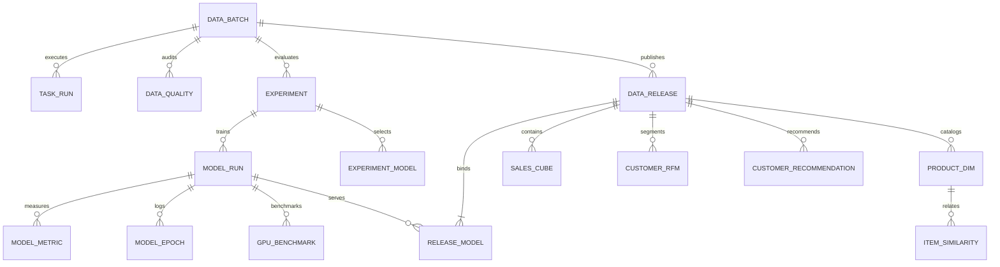

# 06 数据库设计

版本 HL-DOC-1.0.0，数据库schema迁移001，FROZEN。本文为逻辑/物理字段规范，不含DDL。

## 1. 通用约束

MariaDB10.11、InnoDB、utf8mb4；业务ID及代码列使用utf8mb4_bin，UUID与hash为ASCII二进制排序。所有时间审计字段DATETIME(6)，应用保证UTC；source_date为DATE，不做时区转换。钱为DECIMAL(20,2)，仅GBP；内部便士转换需范围检查。所有列默认NOT NULL，以下标“可空”才允许NULL；没有列出的隐式默认值。金额/数量计数非负，net_amount可负；score可负但必须有限；布尔取0/1；rank∈[1,10]；主键/外键/唯一键不得只靠页面保证。

枚举用VARCHAR与CHECK限制，避免数据库原生ENUM迁移锁表。公共created_at/updated_at由应用写UTC，无隐式本地时间。下文PK主键、UK唯一键、FK外键；删除均RESTRICT，无业务表级联删除。

## 2. 控制表

### data_batch

PK batch_id CHAR(23)。source_sha256 CHAR(64)、source_name VARCHAR(255)、source_url VARCHAR(1024)、source_bytes BIGINT、policy_version VARCHAR(32)、baseline_version VARCHAR(32)、schema_version VARCHAR(16)、status VARCHAR(16)、raw_hdfs_path VARCHAR(1024)、normalized_hdfs_path VARCHAR(1024)、created_at/updated_at DATETIME(6)。可空：min_source_date/max_source_date DATE、raw_rows/sale_rows/return_rows/rejected_rows BIGINT、quality_report_path VARCHAR(1024)、error_code VARCHAR(64)、error_message VARCHAR(1024)。UK(source_sha256,policy_version)；status范围见05。

### task_run

PK run_id CHAR(36)；FK batch_id→data_batch；可空FK parent_run_id→task_run。字段task_name VARCHAR(64)、attempt INT、status VARCHAR(16)、config_sha256 CHAR(64)、code_commit VARCHAR(64)、baseline_version VARCHAR(32)、created_at DATETIME(6)。可空started_at/finished_at/heartbeat_at DATETIME(6)、application_id VARCHAR(64)、pid BIGINT、process_start_utc DATETIME(6)、output_manifest_path/log_path VARCHAR(1024)、error_code VARCHAR(64)、error_message VARCHAR(1024)。UK(batch_id,task_name,attempt)，INDEX(batch_id,status,created_at)。status取05终态机；进程身份不能只存PID。

### experiment

PK experiment_id CHAR(36)；FK batch_id；status VARCHAR(16)取CREATED/RUNNING/SUCCEEDED/FAILED；split_policy_version VARCHAR(32)固定time-split-v1、train_end_exclusive DATE固定2011-09-01、validation_end_exclusive DATE固定2011-11-01、seed INT固定42、config_sha256 CHAR(64)、baseline_version VARCHAR(32)、created_at DATETIME(6)。可空champion_algorithm VARCHAR(8)、report_path VARCHAR(1024)、test_sealed_at/finished_at DATETIME(6)。champion取四算法；只有SUCCEEDED可用于release。

### model_run

PK model_run_id CHAR(36)；FK batch_id→data_batch、experiment_id→experiment、run_id→task_run。algorithm VARCHAR(8)取POP/ITEMCF/ALS/NCF；purpose VARCHAR(8)取EVAL/FULLFIT；device VARCHAR(8)取CPU/CUDA；status VARCHAR(16)取CREATED/RUNNING/SUCCEEDED/FAILED；config_sha256、mapping_sha256 CHAR(64)，artifact_path VARCHAR(1024)，code_commit VARCHAR(64)、environment_sha256 CHAR(64)、baseline_version VARCHAR(32)、created_at DATETIME(6)。可空finished_at DATETIME(6)、best_epoch INT、validation_ndcg DOUBLE、hardware_summary VARCHAR(1024)。FK的一致batch由发布器检查；FULLFIT和EVAL不可混用。

### experiment_model

PK(experiment_id,algorithm)，FK experiment_id→experiment、model_run_id→model_run；algorithm VARCHAR(8)取四算法；selected_at DATETIME(6)。每实验恰好四个选定EVAL模型，只有验证完成可写，测试封存后不可修改。用于指标端点、champion、FULLFIT超参数来源，不能通过created_at猜“最新候选”。

### data_quality

PK(batch_id,metric_name VARCHAR(64))，FK batch_id→data_batch；metric_value BIGINT非负、description VARCHAR(512)、updated_at DATETIME(6)。指标键见04；拒绝明细保留HDFS。不依赖release即可查询失败/处理中批次的已有质量统计。某批次当前成功pipeline确定后冻结其最终质量结果，失败attempt报告通过task_run的manifest单独追溯。

### model_epoch

PK(model_run_id,epoch)，FK model_run_id；epoch INT从1；train_loss DOUBLE、elapsed_seconds DOUBLE。可空validation_loss/validation_ndcg DOUBLE、peak_gpu_mib DOUBLE。只记录实际执行epoch，不补齐虚假曲线；非NCF不要求epoch行。

### model_metric

PK(model_run_id,split_name,cohort,k)，FK model_run_id；split_name VARCHAR(16)取VALIDATION/TEST；cohort VARCHAR(16)取WARM/ALL_ELIGIBLE；k INT固定10；user_count/catalog_count/window_user_count BIGINT、precision_at_k/recall_at_k/ndcg_at_k/coverage DOUBLE、cold_user_count/cold_item_count/cold_interaction_count/excluded_user_count BIGINT、candidate_policy_version VARCHAR(32)、created_at DATETIME(6)。零分母不能写NaN，无可评价用户使实验失败，具体分母见07。

### gpu_benchmark

PK benchmark_id CHAR(36)；FK model_run_id（EVAL NCF）；device VARCHAR(8)取CPU/CUDA、repeat_index INT（1..3）、seed INT、batch_size INT、epochs INT、warmup_steps INT、train_seconds DOUBLE、samples_per_second DOUBLE、peak_memory_mib DOUBLE（可空）、hardware VARCHAR(1024)、torch_version/cuda_runtime/driver_version VARCHAR(64)（后两CPU可空）、dataset_sha256/config_sha256 CHAR(64)、created_at DATETIME(6)。UK(model_run_id,device,repeat_index)。环境/批量不同的实验不能放同一组加速比。

## 3. 发布控制

### data_release

PK release_id CHAR(23)；FK batch_id、experiment_id；status VARCHAR(16)取BUILDING/READY/FAILED/RETIRED；champion_algorithm VARCHAR(8)、manifest_path VARCHAR(1024)、manifest_sha256 CHAR(64)、baseline_version VARCHAR(32)、created_at DATETIME(6)。可空published_at/retired_at DATETIME(6)、failure_reason VARCHAR(1024)。INDEX(status,published_at)。READY数据不可更新。

### release_model

PK(release_id,algorithm)，FK release_id、model_run_id；algorithm VARCHAR(8)；UK(release_id,model_run_id)。恰好四行，均为同batch和experiment的FULLFIT/SUCCEEDED；这些跨行约束在发布事务前核验。

### current_release

PK singleton_id TINYINT，CHECK=1；FK release_id（可空，首次部署）；updated_at DATETIME(6)。迁移建立单例行；发布/回滚时事务SELECT FOR UPDATE锁定该行。

### release_event

PK event_id CHAR(36)；action VARCHAR(16)取PUBLISH/ROLLBACK/RETIRE；可空FK from_release_id、to_release_id→data_release；reason VARCHAR(1024)、operator VARCHAR(64)、created_at DATETIME(6)。回滚需要reason；首次publish允许from为空。

## 4. 只读业务结果表

以下表每行均有FK release_id，查询必须指定release_id；没有“默认最新行”。

| 表 | 主键与字段 | 约束、索引和用途 |
|---|---|---|
| product_dim | PK(release_id,stock_code VARCHAR(32))；description VARCHAR(512)可空，is_merchandise/is_candidate BOOLEAN | is_candidate仅为全历史至少被一名有效客户正向购买的合格商品；按stock_code检索，描述来自04 |
| sales_cube | PK(release_id,source_date DATE,country VARCHAR(64),stock_code)；gross_amount/return_amount DECIMAL(20,2)，sale_quantity/return_quantity BIGINT | FK(release_id,stock_code)→product_dim；INDEX(release_id,country,source_date)；net查询为差值 |
| sale_order | PK(release_id,invoice_no VARCHAR(32))；source_date DATE、country VARCHAR(64)、customer_id VARCHAR(32)可空、gross_amount DECIMAL(20,2) | INDEX(release_id,source_date,country)、INDEX(release_id,country,source_date)、INDEX(release_id,customer_id)；摘要订单数、客户数及RFM依据 |
| sale_order_item | PK(release_id,invoice_no,stock_code)；gross_amount DECIMAL(20,2)、quantity BIGINT | FK订单→sale_order，FK商品→product_dim；INDEX(release_id,stock_code,invoice_no)；商品distinct订单与筛选 |
| customer_rfm | PK(release_id,customer_id)；last_purchase/as_of_date DATE、recency_days/frequency INT、monetary DECIMAL(20,2)、r_score/f_score/m_score TINYINT、segment VARCHAR(16) | score1..5，segment见04；INDEX(release_id,segment,customer_id) |
| customer_seen_item | PK(release_id,customer_id,stock_code) | FK客户→customer_rfm，FK商品→product_dim；只保留合格商品；全量服务历史已购过滤与可候选数 |
| item_similarity | PK(release_id,stock_code,related_stock_code)；similarity/confidence/lift DOUBLE、co_count BIGINT、rank TINYINT | 两个FK商品；UK(release_id,stock_code,rank)；禁止自关联，相似度0..1 |
| product_popularity | PK(release_id,stock_code)；order_count BIGINT、rank INT | FK商品；UK(release_id,rank)；覆盖整个合格目录，未知客户兜底无需在线模型 |
| customer_recommendation | PK(release_id,algorithm,customer_id,stock_code)；rank TINYINT、score DOUBLE、reason_code VARCHAR(32)、is_fallback BOOLEAN | FK(release_id,algorithm)→release_model，FK客户与商品；UK(release_id,algorithm,customer_id,rank) |

全量推荐目录C_full取product_dim.is_candidate=true，is_candidate必蕴含is_merchandise。RFM客户可能没有任何合格商品，仍保留客户并为其推荐热门；四算法customer_recommendation须覆盖所有RFM客户，只要存在可推荐商品。全目录已购客户允许0条，以expected_user_count及无候选数核验，不能通过缺行认定遗漏。product_popularity只覆盖C_full，匿名订单对C_full内商品的购买可计热门订单数，但不能单独引入目录外商品。

## 5. 一致性、索引与事务

图为核心关系总览；所有复合外键、当前指针、订单和seen关系以字段表为准，不能从简图推断删除级联。

以同一release从sales_cube计算金额，从sale_order计算订单/客户；二者过滤日期/国家语义相同。商品榜金额来自cube、不同订单数来自sale_order_item联接sale_order，不直接join明细后重复加金额。月聚合对来源日期截到月；订单只能单日，月订单数可加日distinct订单数。

按分页排序列增加确有性能需求的索引需通过查询计划证明，可作为实施优化，但不能改变协议排序。查询用参数绑定；page_size上限100；推荐禁止全表扫描后在UI过滤。

导入先BUILDING数据，分表分批提交不暴露给查询；最终校验与current切换为一个短事务。批次唯一键防止重导，单行推荐UK防止重试重复。失败release允许清理后重新使用新release_id，不在READY版本上做upsert。

## 6. 迁移、保留与备份

数据库名`retail_analytics`。实现需提供有序迁移及schema_migration控制表：PK version VARCHAR(32)、description VARCHAR(255)、checksum CHAR(64)、applied_at DATETIME(6)。迁移前备份，不修改已应用迁移；CHECK/FK必须在目标MariaDB实测。

DB账号分离：migration账号仅离线使用，writer用于任务/发布，reader仅SELECT业务和脱敏控制字段。root不供API使用。SQL密码从受限环境文件注入。

至少保留当前版本和前两个成功release、其模型及HDFS来源；实验指标与发布事件永久保留课程周期。退休只在确认无current引用且保留期过后进行，清理先登记事件、标RETIRED，再按引用逆序清理子表；控制表和manifest保留，具体见10。
