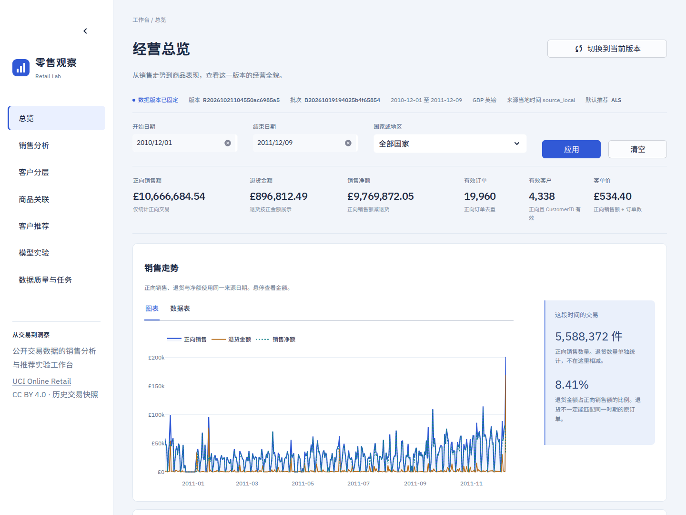
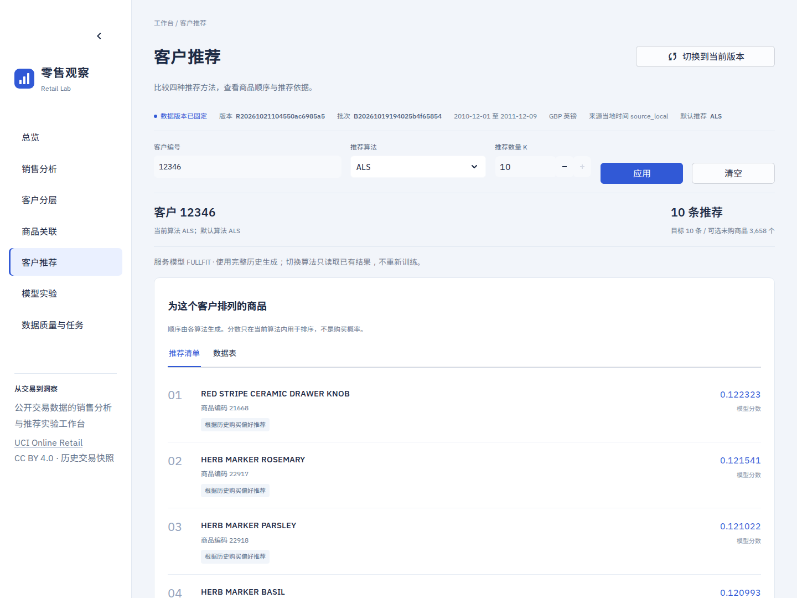

# W10 七页工作台与真实 UI 验收

基线：`HL-DOC-1.0.0`；依赖提交：`3988c57`；实现提交：`778c178de0b3687290fe4202f219239b9479792f`。用户明确要求使用 frontend-design skill 重新设计并完成 W10。本记录为执行证据，不修改冻结页面/API/数据规范。

## 完成范围

依据 [02 页面规范](../02-ux.md)、08 API 和 T-16，实现 FR-10 的七页中文 Streamlit 工作台，接入 W09 已发布的真实结果，覆盖 FR-03—08 的分析与模型展示、FR-09 的版本固定、FR-11 的任务追溯，以及 NF-01/06/07 的相关约束。

正式输入：release `R20261021104550ac6985a5`，batch `B20261019194025b4f65854`，experiment `acea8dc1-3b09-43b8-ac79-09571cfcca53`，champion ALS。源 SHA-256 为 `43465a06f2ccf7c8b5bd2892bc7defb52f97487934fe93b16ae4c3936424676d`。

| 页面 | 已实现与验证 |
|---|---|
| 总览 | 六项精确指标、同筛选日趋势、Top20 商品/交易项；金额 GBP、客户口径、退货/正向销量区分 |
| 销售分析 | 日期/国家、日月粒度、国家净额/正向额排序、商品销售额/销量排序，独立明细分页 |
| 客户分层 | 五类完整分层图及表、RFM 基准日、编号/分层筛选、分页，行选择进入客户推荐 |
| 商品关联 | 实际共购关系、K、相似度/共现次数/置信度/提升度与表格，不存在与无关联分别处理 |
| 客户推荐 | 四算法与默认 champion、实际 rank/score、固定中文原因、未知客户热门兜底、短列表/全目录已购空态 |
| 模型实验 | 选定 EVAL 四算法指标、split/cohort、冷启动规模；NCF EVAL/FULLFIT 曲线隔离；CPU/CUDA 六次计时及真实硬件 |
| 数据质量与任务 | 原始/正向/退货/拒绝、缺失/重复/大篮子截断；来源 hash、任务最新尝试链、历史失败、run 详情、UTC 耗时与 YARN ID |

不增加上传、训练、发布、删除、任意 SQL/shell 或作业重试入口。旧 `app/demo/` 不作为数据来源或正式页面，仍保留本地未提交状态。

## 视觉与交互

按 skill 先形成 [设计方案与复核](2026-10-22-w10-design.md)，再编码和截图自评。冷白/雾蓝工作区、蓝色销售主图、琥珀退货、青碧验证序列；连续指标带不使用六张相同卡片。开源字体本地子集化并更名，保留许可证与摘要，运行时不加载外部字体或图片。





手机总览：[390 像素截图](w10-overview-390.png)。其他七页和视口截图位于 `var/w10/screenshots/`，逐张摘要记录在机器报告中。

全局固定 release，切页不重取 current；用户明确点击“切换到当前版本”才重新读取并清空筛选/选择。表单编辑与已应用条件分离，清空恢复默认；实现过程中修正了 Streamlit 动态 value/index 导致二次编辑被覆盖的问题。只缓存版本内筛选词表与默认编号，不缓存上次查询结果冒充成功。

图表对应精确数据表，日期采用来源本地时间；金额使用 Decimal，未知客单价显示“—”。RFM 不随销售筛选重算；服务推荐和 EVAL 指标分别解释。无 release 禁用业务提交，实验/任务仍可查看；错误保留输入并显示请求 ID 与查询重试；版本退休不自动切换；缺失训练/benchmark 不填造结果。

## 依赖、边界与部署

实际首次表格渲染暴露 PyArrow 26.0.0 与 NumPy 1.26.4 的导入冲突。通过 uv 显式固定 PyArrow 17.0.0；其余既有包版本保持，NumPy/Pandas/PyTorch/Spark/CUDA 均未升级。新增开发工具 Playwright 1.56.0 及其依赖，供浏览器验收使用。`uv pip check` 和 `uv sync --locked --offline --check` 均通过。

`app/client.py` 为唯一数据通道，GET/5 秒时限/回环 URL 校验/固定版本 meta 校验/安全错误封装。UI 启动器不向子进程传入数据库凭据。页面未导入数据库或模型执行模块，仅配置加载器读取非敏感项目配置；不修改迁移、权限或正式数据。

API 实际监听 `127.0.0.1:8000`，UI 实际监听 `127.0.0.1:8501`。Windows PowerShell 对 `http://localhost:8501/_stcore/health` 的检查返回 200。启动及停止方式见 [页面说明](../../app/README.md)。

## 实际验收

| 验证 | 结果与证据 |
|---|---|
| 提交后全量回归 | `uv run --locked python -m pytest -q --maxfail=2`：191 passed，182.95 秒，无失败/跳过；仅既有 Starlette/AnyIO 弃用提示 |
| W10 自动用例 | 13 项：10 项 AppTest 经 ASGI HTTP transport 桥接实际 W09 TestClient 和独立真实 MariaDB；3 项状态/HTTP/凭据边界测试 |
| 生命周期与失败 | 覆盖 current 变化不自动漂移、显式切换重置、无 release 控制页可用、退休版本、输入保留与请求 ID、错误不显示旧结果 |
| 数据与推荐 | 超界日期空集/金额 0/AOV 未知、二次筛选与清空、四算法未知客户、K 不足与全目录已购、存在无关联与商品 404 |
| 真实浏览器 | 153 项通过；真实 HTTP/WebSocket UI + W09 API，无数据库 mock 或合成数据替代 |
| 图形与设备 | 17 张截图；1440/1024/768/390/360 像素；Chromium 141.0.7390.37，明确禁用 GPU 渲染；JS 错误 0、外部运行时资源请求 0 |
| 浏览器真实交互 | 草稿不提交、超界空态与清空、France 同筛选国家排行、月粒度、商品/客户分页、客户查找、实际 YARN 任务详情、NCF 兜底与显式版本切换、键盘可见焦点 |
| 协议与文档 | 原 18 份冻结文档 SHA-256 复核一致，无迁移和 API 协议变更 |

完整浏览器证据见 [w10-browser-2026-10-22.json](w10-browser-2026-10-22.json)。执行时 HEAD 为上述实现提交，tracked_code_dirty=false，implementation_untracked 为空；报告含环境/配置/锁摘要、源 hash、版本/批次/实验、检查清单、截图路径与 SHA-256。

完整测试日志为 `var/w10/regression-778c178.log`。浏览器使用命令：

```bash
source scripts/dev-env.sh
PLAYWRIGHT_BROWSERS_PATH="$PWD/var/cache/playwright" \
uv run --locked python scripts/verify-w10.py \
  --config config/development.toml \
  --output var/w10/browser-verification.json
```

实际页面继续展示 W08/W09 已验证的 £10,666,684.54 正向销售、£896,812.49 退货和 £9,769,872.05 净额。NCF 对照仍为 CPU/GPU 中位数约 13.34/25.25 秒、0.53×；页面明确说明本次 GPU 更慢。本轮没有新训练或正式数据发布，页面刷新不能被当作训练执行证据。

## 交接

W10 的 T-16 已完成，配合 W09 的 T-15/T-17，API 与页面功能验收通过。W11 全链路性能/资源扩展/完整报告与演示尚未执行；W08 的独立物理盘备份仍等待外部存储，不能据此标记全项目完成。

依赖、实现与交互测试、执行证据按三个主题原子提交，使用中文 Conventional Commits；不重写历史，不提交凭据、原始数据、模型权重或旧 Demo。推送后核对远程 main 与本地 HEAD，回执保留在 `var/w10/push-receipt.json`。
